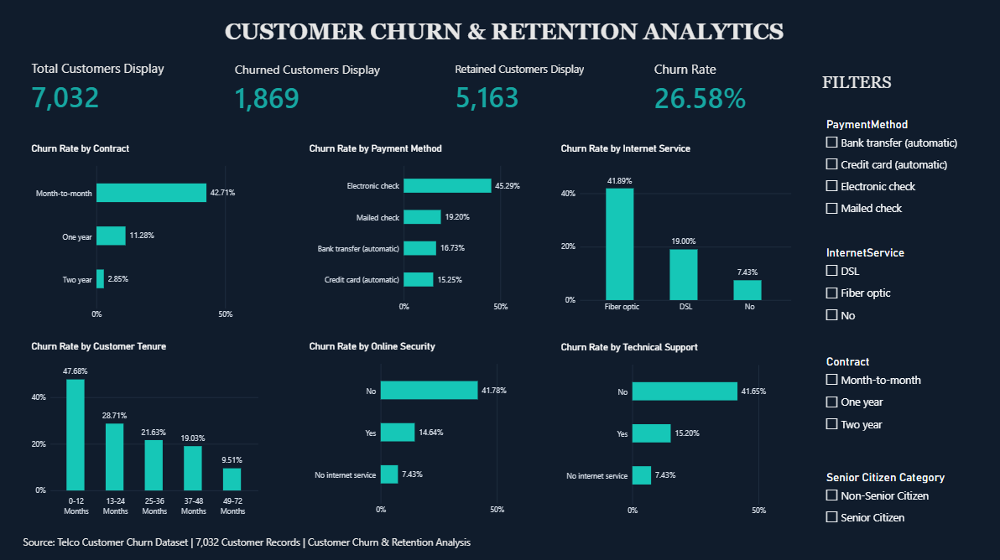

# Customer Churn & Retention Analytics

An end-to-end data analytics project exploring customer churn patterns and retention opportunities using **Python, MySQL and Power BI**.

## Dashboard Preview



## Key Business Insights

- **Overall Churn:** 26.58% of customers have churned, representing 1,869 out of 7,032 customers.
- **Contract Type:** Month-to-month customers have the highest churn rate at 42.71%, compared with 2.85% for two-year contracts.
- **Internet Service:** Fiber optic customers show a churn rate of 41.89%, higher than DSL customers at 19.00%.
- **Payment Method:** Customers using electronic checks have the highest churn rate at 45.29%.
- **Customer Support:** Customers without tech support have a churn rate of 41.65%, compared with 15.20% among customers with tech support.
- **Tenure:** Customers with 0–12 months of tenure have the highest churn rate at 47.68%.

## Business Recommendations

- Encourage customers to move from month-to-month to longer-term contracts.
- Investigate customer dissatisfaction among fiber optic users.
- Review the customer experience for electronic check users.
- Improve awareness and accessibility of technical support services.
- Introduce targeted retention campaigns for newly acquired customers.

## Project Overview

Customer churn is an important challenge for subscription-based businesses. This project analyses customer data to understand churn behaviour, identify customer segments with higher churn rates, and highlight insights that can support customer retention strategies.

## Objectives

- Understand overall customer churn and retention.
- Explore customer demographics and service usage patterns.
- Identify customer segments with higher churn rates.
- Analyse the relationship between contracts, payment methods and churn.
- Build an interactive Power BI dashboard to communicate findings.

## Tools & Technologies

| Tool | Purpose |
|---|---|
| Python | Data cleaning and exploratory data analysis |
| Pandas | Data manipulation |
| Matplotlib & Seaborn | Data visualization |
| MySQL | SQL-based analysis |
| Power BI | Interactive dashboard development |
| Jupyter Notebook | Python analysis environment |

## Dataset

The project uses a Telco Customer Churn dataset.

- Original records: 7,043
- Cleaned records: 7,032
- Features after cleaning: 22
- Missing values in cleaned dataset: 0

The 11 records with missing `TotalCharges` values were removed during data cleaning.

## Project Workflow

1. **Data Understanding** – Inspected the dataset, columns and data types.
2. **Data Cleaning** – Handled missing values and prepared the cleaned dataset.
3. **Exploratory Data Analysis** – Examined churn patterns across customer demographics, services and contract types.
4. **SQL Analysis** – Used MySQL queries to investigate churn and customer behaviour.
5. **Dashboard Development** – Built an interactive Power BI dashboard with KPIs, charts and slicers.

## Key Findings

- Overall customer churn rate: **26.58%**
- Month-to-month contract churn rate: **42.71%**
- One-year contract churn rate: **11.28%**
- Two-year contract churn rate: **2.85%**
- Fiber optic customer churn rate: **41.89%**
- Electronic check payment churn rate: **45.29%**

These findings indicate that churn rates differ considerably across contract types, internet services and payment methods. The relationships are observational and do not establish causation.

## Power BI Dashboard

The interactive dashboard presents:

- Total customers
- Churned customers
- Retained customers
- Overall churn rate
- Churn rate by contract type
- Churn rate by internet service
- Churn rate by payment method
- Churn rate by customer tenure
- Churn rate by online security
- Churn rate by technical support

Interactive slicers allow users to explore customer segments.

## Repository Structure

```text
customer-churn-retention-analysis/
│
├── notebooks/
│   ├── README.md
│   └── 02_Exploratory_Data_Analysis.ipynb
│
├── sql/
│   └── customer_churn_analysis.sql
│
├── Customer_Churn_Retention_Dashboard.pbix
├── Telco-Customer-Churn-Cleaned.csv
└── README.md
```

## How to Explore This Project

1. Download the cleaned dataset from this repository.
2. Open the Python notebook using Jupyter Notebook or Google Colab.
3. Run the SQL queries in MySQL Workbench after setting up the database and importing the cleaned dataset.
4. Open the `.pbix` file using Power BI Desktop to explore the dashboard.

## Conclusion

This project demonstrates an end-to-end data analytics workflow, from data preparation and exploratory analysis to SQL querying and interactive dashboard development.

**Project Focus:** Customer Behaviour | Churn Analysis | Retention Analytics | Data Visualization
